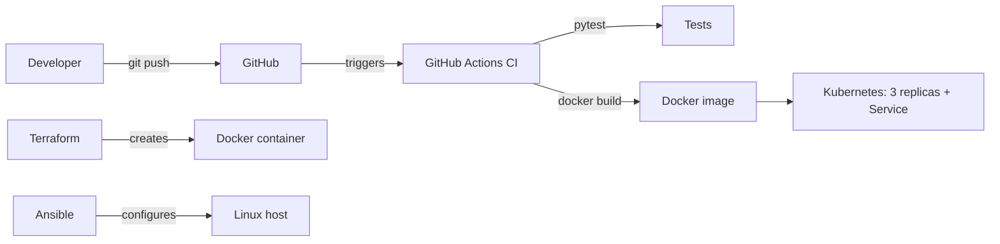

# DevOps Project: Flask App from Code to Kubernetes

A small Flask web app taken through a complete DevOps toolchain: containerized with Docker, tested and built by CI on every push, configured with Ansible, deployed to Kubernetes, and provisioned with Terraform.

## Architecture



## Tools and what each one does here

| Tool | Role in this project |
|---|---|
| **Linux (Ubuntu on WSL)** | Environment everything runs on |
| **Flask** | The app: `/` returns a greeting, `/health` returns `{"status": "ok"}` |
| **Docker** | Packages the app and its dependencies into an image |
| **GitHub Actions** | CI: runs `pytest` and builds the Docker image on every push |
| **Ansible** | Playbook that installs packages and sets up the app folder (idempotent) |
| **Kubernetes (kind)** | Runs 3 replicas, a Service, and a readiness probe on `/health`; self-heals deleted pods |
| **Terraform** | Declares the app container as code (`init`, `plan`, `apply`, `destroy`) |

## Project structure

```
.
├── app.py                  # Flask app
├── test_app.py             # pytest tests
├── requirements.txt
├── Dockerfile
├── .github/workflows/ci.yml  # CI pipeline
├── ansible/                # inventory + playbook
├── k8s/app.yml             # Deployment + Service
└── terraform/main.tf       # Docker container as code
```

## Run it yourself

**1. Locally with Docker**

```bash
docker build -t myapp:2 .
docker run -d -p 5000:5000 --name myapp myapp:2
curl http://localhost:5000
```

**2. Tests**

```bash
pip install -r requirements.txt pytest
pytest
```

**3. Ansible**

```bash
cd ansible
ansible-playbook -i inventory.ini playbook.yml --ask-become-pass
```

**4. Kubernetes (kind)**

```bash
kind create cluster --name devops
kind load docker-image myapp:2 --name devops
kubectl apply -f k8s/app.yml
kubectl port-forward svc/myapp 8080:80
```

**5. Terraform**

```bash
cd terraform
terraform init
terraform apply
curl http://localhost:5001
terraform destroy
```

## What I learned

- Containers package an app so it runs the same everywhere.
- CI catches broken code on every push instead of after deployment.
- Declarative tools (Ansible, Kubernetes, Terraform) describe the desired state and converge to it, so repeated runs are safe.
- Kubernetes keeps the declared number of replicas running and replaces failed pods automatically.

## Next steps

- Add a CD step that pushes the image to a registry on every merge
- Deploy to a cloud Kubernetes cluster using Terraform
- Add monitoring with Prometheus and Grafana
